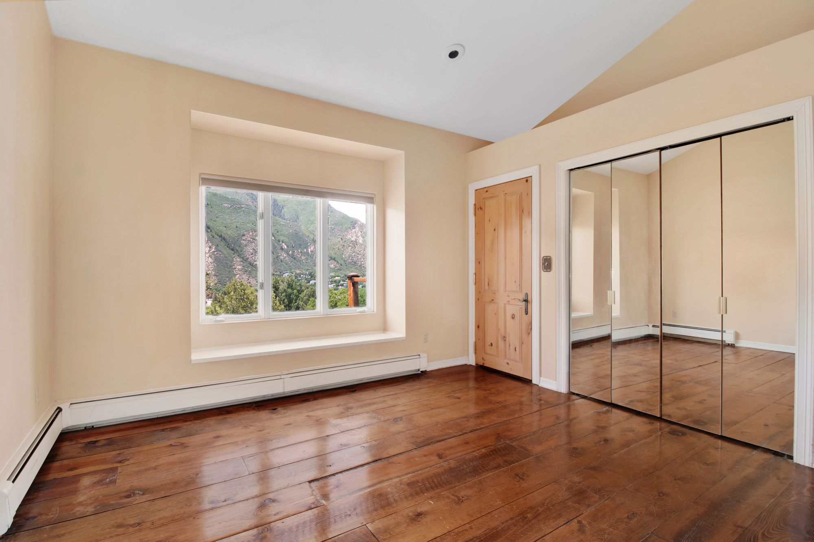

# Brief vidéo — hero d'accueil

Aucune vidéo n'a été fournie pour ce projet. **Aucun fichier factice n'a été créé** :
le dossier `assets/video/` est volontairement vide. Le hero fonctionne parfaitement en
image fixe et le passage à la vidéo ne demandera aucune refonte.

Ce document sert de cahier des charges pour le tournage ou la sélection d'une séquence
existante.

---

## 1. Concept

**« Regarder de plus près. »**

La séquence ne montre pas un beau parquet : elle montre un **regard qui examine** un
parquet. Le mouvement va du général au détail, comme le fait une expertise. Pas de
sourire client, pas de main serrée, pas de logo animé.

Registre : documentaire technique, lumière naturelle, rythme lent, aucune musique
imposée (la vidéo est muette en usage hero).

---

## 2. Durée et rythme

| Paramètre | Valeur |
| --- | --- |
| Durée totale | **8 à 12 secondes**, bouclées |
| Nombre de plans | 3 à 4 maximum |
| Durée par plan | 2,5 à 4 s |
| Transitions | coupes franches, ou fondu très court (150–200 ms) |
| Mouvement caméra | lent et continu, jamais saccadé |
| Boucle | le dernier plan doit pouvoir enchaîner sur le premier sans rupture visuelle |

Une boucle courte et calme vaut mieux qu'une séquence longue : elle se charge vite et ne
détourne pas l'attention du message.

---

## 3. Storyboard

### Plan 1 — L'espace (3 s)

- **Cadrage** : plan large d'une pièce vide ou peu meublée, parquet au premier plan.
- **Mouvement** : travelling avant très lent, ou léger panoramique latéral.
- **Lumière** : naturelle, rasante, venant d'une fenêtre latérale — elle révèle le relief.
- **Intention** : poser le contexte, laisser le titre respirer.

### Plan 2 — Le détail (3 s)

- **Cadrage** : macro sur une jonction de lames, un joint ouvert, un chant légèrement
  soulevé ou un tuilage.
- **Mouvement** : léger travelling latéral, faible profondeur de champ.
- **Intention** : c'est le plan qui dit « il y a un problème » sans le dramatiser.

### Plan 3 — Le geste technique (3 s)

- **Cadrage** : mains d'un opérateur posant un appareil de mesure d'humidité sur le sol,
  ou glissant une règle le long du parquet. **Cadrer les mains et l'outil, pas le visage.**
- **Mouvement** : caméra fixe ou très léger recadrage.
- **Intention** : la méthode, la mesure, le sérieux.

### Plan 4 — Facultatif (2,5 s)

- **Cadrage** : lumière qui traverse la pièce et balaie le parquet, ou léger flou de
  fermeture pour faciliter le raccord avec le plan 1.
- **Intention** : refermer la boucle.

---

## 4. Ce qu'il faut éviter

- Visages en gros plan, sourires, poignées de main.
- Sur-étalonnage : teintes orangées saturées, contrastes forcés.
- Plans très courts, ralentis spectaculaires, drone.
- Matériel de chantier trop visible : le sujet est le diagnostic, pas les travaux.
- Tout élément permettant d'identifier une entreprise, une marque ou une personne.

---

## 5. Formats de livraison

| Usage | Format | Résolution | Débit cible | Poids visé |
| --- | --- | --- | --- | --- |
| Desktop principal | WebM (VP9 ou AV1) | 1920 × 1080 | 1,2–2 Mb/s | **< 2 Mo** |
| Repli desktop | MP4 (H.264, yuv420p, `faststart`) | 1920 × 1080 | 1,5–2,5 Mb/s | < 2,5 Mo |
| Mobile (facultatif) | WebM + MP4 | 1280 × 720 recadré | 0,8–1,2 Mb/s | < 1 Mo |
| Poster | JPEG ou WebP | 2000 px de large | — | < 250 Ko |

Contraintes techniques :

- **Aucune piste audio** (elle serait inaudible et alourdirait le fichier).
- Cadence 24 ou 25 i/s.
- Le poster doit correspondre à la **première image** de la vidéo, pour éviter tout saut
  visuel au démarrage.
- Nommage attendu : `assets/video/hero.webm`, `assets/video/hero.mp4`,
  poster `assets/images/hero.jpg`.

### Encodage de référence

```bash
# WebM (VP9)
ffmpeg -i source.mov -an -c:v libvpx-vp9 -b:v 1500k -crf 34 \
  -vf "scale=1920:-2,fps=25" -row-mt 1 assets/video/hero.webm

# MP4 (H.264)
ffmpeg -i source.mov -an -c:v libx264 -profile:v high -pix_fmt yuv420p \
  -b:v 2000k -vf "scale=1920:-2,fps=25" -movflags +faststart assets/video/hero.mp4

# Poster : première image
ffmpeg -i source.mov -vframes 1 -q:v 2 assets/images/hero.jpg
```

---

## 6. Intégration

Le hero est déjà structuré pour la vidéo. Il suffit de remplacer le `` de
`.hero__media` (dans `tools/content/home.mjs`, puis `node tools/build.mjs`) par :

```html
<video autoplay muted loop playsinline preload="metadata"
       poster="assets/images/hero.jpg" width="1920" height="1080">
  <source src="assets/video/hero.webm" type="video/webm">
  <source src="assets/video/hero.mp4" type="video/mp4">
  <!-- Repli si le navigateur ne lit aucune des sources -->
  
</video>
```

Points déjà pris en charge par le CSS existant (`css/pages/home.css`) :

- `.hero__media video` reçoit les mêmes règles que l'image (`object-fit: cover`,
  cadrage `center 62%`) ;
- le double dégradé de lisibilité est appliqué **par-dessus** le média, quel qu'il soit ;
- la hauteur du hero est fixée en `clamp()`, donc aucun décalage de mise en page (CLS)
  au moment où la vidéo se substitue au poster.

### Attributs indispensables

| Attribut | Raison |
| --- | --- |
| `muted` | condition sine qua non de l'autoplay sur tous les navigateurs |
| `playsinline` | empêche le passage en plein écran automatique sur iOS |
| `loop` | boucle continue |
| `preload="metadata"` | évite de télécharger la vidéo entière avant l'affichage |
| `poster` | image immédiate pendant le chargement |
| `width` / `height` | réservation du ratio, protection contre le CLS |

---

## 7. Mobile et accessibilité

### Mobile

Sur petit écran, la vidéo coûte cher en données et en batterie pour un bénéfice faible.
Deux stratégies possibles, au choix :

1. **Recommandée** — ne pas charger la vidéo sous 768 px et conserver l'image.
2. Charger une version 720p recadrée en portrait.

Pour la première stratégie, remplacer le média par le poster côté script plutôt que par
`display: none` (une vidéo masquée est tout de même téléchargée) :

```js
// à ajouter dans js/modules/ si la vidéo est mise en place
const video = document.querySelector('.hero__media video');
if (video && window.matchMedia('(max-width: 767px)').matches) {
  video.removeAttribute('autoplay');
  video.pause();
}
```

Prévoir aussi de respecter l'économiseur de données lorsqu'il est signalé
(`navigator.connection.saveData`).

### `prefers-reduced-motion`

**Obligatoire.** Une vidéo en boucle est un mouvement automatique : elle doit s'arrêter
pour les personnes qui ont demandé une réduction des animations.

```css
/* à ajouter dans css/pages/home.css lors de la mise en place */
@media (prefers-reduced-motion: reduce) {
  .hero__media video { display: none; }
  .hero__media .hero__poster { display: block; }
}
```

et, côté script, mettre la lecture en pause :

```js
if (window.matchMedia('(prefers-reduced-motion: reduce)').matches && video) {
  video.removeAttribute('autoplay');
  video.pause();
}
```

### Contraste

Le texte du hero est blanc sur le média. Le dégradé actuel garantit la lisibilité sur
l'image fournie ; **vérifier à nouveau le contraste sur la vidéo**, notamment sur le plan
le plus clair de la boucle. Si nécessaire, renforcer l'opacité du dégradé dans
`.hero__media::after` plutôt que d'assombrir la vidéo à l'encodage.

---

## 8. Droits

La vidéo retenue doit être libre d'usage commercial et documentée dans
`assets/images/CREDITS.md` (source, auteur, licence, date de récupération), au même titre
que les photographies. Si des personnes sont identifiables — même de dos — une
autorisation écrite est nécessaire.
